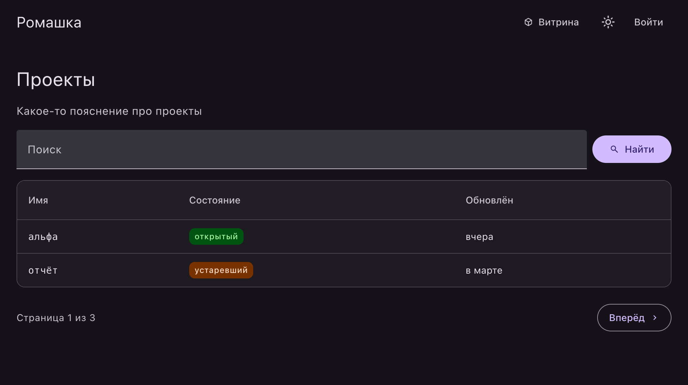

# oscript-ui

UI-кит для веб-приложений на чистом [OneScript](https://oscript.io): компоненты,
каркас форм, дерево узлов экрана, токены темы, иконки и собственный базовый лист стилей.
Классы кита — желуди [ОСени](https://github.com/autumn-library/autumn), но зависимости
на неё у библиотеки нет.

**Зачем.** Чтобы можно было декларативно рисовать веб-приложения на оскрипте.

**Облик — Material Design 3.** Кит не придумывает свой дизайн, а следует
[Material Design 3](https://m3.material.io) — системе Google, на которой стоит и MUI.
Цвета — роли M3, шрифт — её типографическая шкала, скругления, тени, слои состояний
и кривые движения — её токены (`--md-sys-*`), иконки — Material Symbols. Кнопки, поля,
флажки, переключатели, меню, ящик навигации, нижний лист, диалог, вкладки, чипы
и таблица нарисованы по её анатомии.

Вся схема цветов выводится из одного акцента. Акцент по умолчанию — базовый цвет M3
`#6750a4`; инсталляция и посетитель задают свой, и роли светлой и тёмной темы пересчитываются
из него на сервере. Контраст пар ролей держит таблица тонов, а не удачный выбор цвета.
Тест `ТемаMaterial` проверяет это на девяти акцентах, включая белый, чёрный и жёлтый.

Движение — как у MUI. Слой состояния на наведении, плавающая подпись поля и рамка
фокуса, раскрытие меню из угла, выезд шторки и листа, проявление диалога,
раскрытие аккордеона — это CSS. Рябь от точки нажатия, пустота поля, тень шапки при
прокрутке и скольжение индикатора вкладок между страницами делает скрипт кита
`oscript-ui.js`. Каркас страницы подключает его сам, перед скриптом инсталляции.
Без скрипта страница работает целиком: подпись поля просто стоит наверху, а ряби нет.

Действия — без перезагрузки страницы. Раскрывашки и меню и так не ходят на сервер:
это `<details>` и popover. Тема меняется сразу: обе палитры уже в голове страницы, а
форма переключателя уходит на сервер в фоне. Форма, собранная с `БезПерезагрузки()`,
отправляется запросом, и ответ сервера ложится на страницу на место: прокрутка, фокус
и раскрытые раскрывашки остаются как были. Тумблер с `СохранятьСразу` сохраняет себя
сам. Серверу для этого ничего нового не нужно: он отвечает тем же перенаправлением
обратно на страницу, а без скрипта те же формы работают перезагрузкой.

Шрифт Material — Roboto. Кит его не везёт, как не везёт и MUI: где Roboto установлен
или подключён инсталляцией, страница говорит им, остальные видят системный гротеск.

Прежние имена переменных (`--color-*`, `--space-*`, `--radius-*`, `--shadow-*`,
`--font-*`) остаются псевдонимами ролей Material, поэтому лист инсталляции, написанный
под них, продолжает работать.

**Из коробки.** Поставленный в чужой проект, кит выглядит прилично без единой строки
CSS от потребителя. Всё, что проект хочет изменить — правило, файл статики, палитру, —
он переопределяет штатно, не трогая библиотеку: своё правило вторым листом в каскаде,
свой файл одноимённым объявлением, свою тему и акцент контрактом оформления.

**Одна навигация.** Инсталляция описывает свои дороги ОДИН раз — слотом `МенюХаба`
в обрамлении, — а кит показывает их по ширине экрана. На широком шапка выглядит как
обычно: знак, дороги, переключатель оформления и учётка справа; учётка же и открывает
панель. На телефоне полоса ходов прячется, слева появляется бургер, и панель выезжает
шторкой на всю высоту. Панель одна на обе ширины и содержимое несёт одно: учётка,
дела с числами, дороги, разделы текущего экрана, тема и выход. Выглядит она по месту:
на широком — компактным выпадающим меню у кнопки, на телефоне — шторкой с крестом.
Открытие, закрытие, Esc и щелчок мимо делает движок браузера — скрипта в ките нет
ни строки. Слот не заполнен — шапка остаётся прежней целиком, до последнего байта.

**Меню строки и учётки.** Шестерёнка в строке таблицы и кнопка-учётка — один компонент
`Меню`, и панель у них ведёт себя одинаково, по тем же правилам, что и единое меню.
На широком экране панель выпадает у самой кнопки, а места не хватит — отзеркаливается;
пункты идут строками списка, опасный узнаётся красной подписью. На телефоне панель
к кнопке не привязана: она встаёт листом у нижнего края окна, сверху подпись меню (чьи
это действия), пункты под палец, страница под листом затемнена. Вид пунктов задаёт меню:
ссылка, кнопка окна и форма из одной кнопки выглядят одинаково, какой бы вариант кнопки
ни пришёл от вызывающего; форма с полями остаётся формой.

**Таблица карточками.** `Кит.Таблица().Вид("карточками")` на узком экране (до 720 px) печатает
запись карточкой: шапки у неё нет, и ячейка сама несёт подпись своей колонки — приглушённой
строкой над значением. Подписи нет у заглавной ячейки (по умолчанию первой; другую
называет `Кит.Колонка("…").Заглавная()`, с 0.13), у ячейки с меню строки
(на любой глубине) и у пустой; пустая ячейка на узком экране места не занимает. Колонка,
чьи значения называют себя сами («занято 12 КБ из 100», плашка «активна»), от подписи
отказывается явно — методом `Кит.Колонка("…").БезПодписиВЗаписи()`: подпись над таким
значением была бы дублем. Угадывать это по виду значения кит не берётся — плашка бывает
и состоянием, и названием.
Узкий столбец (`Кит.Ячейка().Вид("узкая")`) в записи растягивается на всю ширину карточки.

**Признак у имени.** Шапка объекта (`ШапкаОбъекта`) принимает в модели поле `Признаки` —
массив структур `Иконка, Подпись`. Каждый признак печатается значком сразу за именем,
в той же строке заголовка, а не в ряду плашек: глиф из набора иконок размером с букву
имени, по средней линии. Подпись обязательна: она печатается `<title>` значка
(`role="img"`) и служит сразу доступным именем и всплывающей подсказкой; признак без
подписи отвергается исключением, с неизвестным глифом — не печатается. Значок держится
за последний символ имени (класс `objhead__tail`, сам значок — `objhead__mark`) и на новую
строку один не уходит; перенос внутри имени прежний. Без признаков шапка печатается как
раньше, байт в байт.

**Известный долг.** Компонент «Меню» (меню строки и учётки) выдаёт идентификаторы панелей
сквозным счётчиком процесса, поэтому страница со строчным меню от запроса к запросу
отдаёт разную разметку — побайтовое сравнение ответов на ней не работает. Единого меню
инсталляции это не касается: его идентификатор постоянен. Подробности — в комментарии
у счётчика идентификаторов, `src/Классы/компоненты/Меню.os`, функция
`СледующийИдентификатор`.

## Переход на 0.10

**Язык узлов.** Экран пишется так, что по коду видно, что встанет на экран: позицией —
обязательное (текст заголовка и кнопки, адрес ссылки, имя и метка поля, вид ряда), дальше
до восьми детей аргументами, всё остальное — слова-методы цепочкой. Строка на месте узла —
текст (экранируется). `.Когда(Условие)` есть у любого узла. Таблица собирается из данных:
`Кит.Таблица(ТаблицаЗначений | Массив)`. Дом настроек и секция — узлы `Кит.ДомНастроек`
и `Кит.Секция`, адрес раздела и токен у дома задаются один раз. Тип поля — системой типов
OneScript: `.ТипЗначения(Тип("Число"))`, `ОписаниеТипов` с квалификаторами. Все правила
и словарь — страница документации «Язык узлов».

Разметка на выходе прежняя, байт в байт. Компоненты со структурой-моделью
(`Кит.Кнопка(Новый Структура(…))`) и строковый вход набора (`Набор.Кнопка().Отрисовать(…)`)
работают как раньше; прежние `Настройки.Отрисовать`, `Настройки.Раздел`, `Настройки.Секция`
и `ОбъявлениеФормы.Поле(Ключ, Метка, Вид, Свойства)` — тоже.

Ломается то, где позиционный смысл аргументов сменился: прежде вторым аргументом шёл вид
(или токен), теперь там ребёнок-текст. Строка, совпавшая с видом рода, и строка внутри
формы останавливают сборку исключением с подсказкой, поэтому прежний вызов не напечатает
слово «полоса» на экране молча.

| Было | Стало |
|---|---|
| `Кит.Область("полоса")`, `Статья`, `Раскрывашка`, `Список`, `Таблица`, `Запись`, `Ячейка`, `Надпись`, `Шапка`, `Основное`, `Подвал`, `Навигация` с видом | `Кит.Область(дети…).Вид("полоса")` |
| `Кит.Заголовок(2, "имя")`, `Кит.Ссылка(Адрес, "пилюля")`, `Кит.Группа(Подпись, "набор")`, `Кит.Примечание(Текст, "пусто")` | `Кит.Заголовок(2, текст…).Вид("имя")` и т. д.: второй аргумент — ребёнок |
| `Кит.Код(Текст, "блочный")`, `Кит.Картинка(Адрес, "значок")`, `Кит.Колонка(Подпись, "узкая")` | `Кит.Код(Текст).Вид("блочный")` и т. д. |
| `Кит.Форма(Адрес, Токен, Вид)` | `Кит.Форма(Адрес, дети…).Токен(Токен).Вид(Вид)`; токен можно задать и предку |
| `Кит.ФормаБезСессии(Адрес, Вид)`, `ФормаОтбора`, `ФормаБезТокена` | `Кит.ФормаБезСессии(Адрес, дети…).Вид(Вид)` |
| форма с относительным адресом печаталась как есть | дописывается к адресу раздела дома вокруг; без дома — исключение «форме нужен абсолютный адрес» |
| `Кит.Плашка(Модель)` и прочие компоненты рисовались сразу | рисуются на печати: ошибка модели (кнопка без подписи) приходит на `Рендер()` |
| у формы вошедшего скрытое поле CSRF было ребёнком в `Дети()` и `Дерево()` | поле печатается формой, ребёнком не числится |
| `ОбъявлениеФормы.Поле(…)` возвращало объявление | возвращает описание поля со словами; `Поле`, `Блок`, `Отрисовать`, `Разобрать` у описания передаются объявлению, цепочки работают |
| крошки дома печатались ссылкой у каждой крошки с адресом | крошки печатает компонент «Крошки»: последняя — текущая страница, текстом с `aria-current="page"`, её адрес не печатается |

Новые ключи словаря интерфейса: `form.error.date` — отказ нечитаемой даты; `chrome.crumbs` —
имя навигации крошек по умолчанию (у дома настроек остаётся `settings.frame.crumbs.label`).

**Единое меню: постоянный порядок групп.** Панель печатает группы в одном порядке на любой
странице: учётка, разделы текущего экрана, дороги (`Навигация`), дела, подвал. Группа,
которой нечего показать, не печатается, остальные не двигаются. Разделы экрана теперь
первая группа под учёткой, и заголовок у неё — имя экрана: у дома настроек его заголовок,
у страницы — `Заголовок` структуры `Заголовок, Разделы` четвёртым параметром
`Каркас.Страница` (массив, как прежде, подписан словарём). На широком экране в выпадающем
меню у кнопки-учётки спрятаны и разделы экрана, и дороги (`hubmenu__section--roads`):
дороги стоят в шапке. У любого пункта — `Счётчик` и `ПодписьСчётчика`; сумму на бургере
и кнопке-учётке, если инсталляция её не задала, кит складывает из числовых счётчиков дел.

**Дом настроек на телефоне.** Меню на телефоне одно — бургер: разделы дома встают в шторку
первой группой, колонка разделов на странице под единым меню прячется, а под заголовком дома
печатается имя и значок текущего раздела (`settings__current`; на широком экране скрыто).

**Рубрики и опасный раздел.** У раздела дерева два новых поля: `Рубрика` (подпись над первым
разделом группы, `tree__rubric`; в ряду шапки не печатается) и `Опасный` (цветом ошибки,
последним, без рубрики; `tree__link--danger`). Узлами — слова `Дом.Рубрика(Подпись)`,
`Раздел.Опасный()` и `Раздел.Счётчик(Число, Подпись)`; прежний `Настройки.Раздел` получил
необязательные `Рубрика` и `Опасный`, поля стоят в структуре всегда.

| Было | Стало |
|---|---|
| в панели: учётка, дела, дороги, разделы экрана | учётка, разделы экрана, дороги, дела — у страниц с разделами разметка панели меняется |
| группа разделов дома подписана «Разделы экрана» (`chrome.menu.section.screen`) | подписана заголовком дома; ключ словаря остаётся для массива без имени |
| в выпадающем меню широкого экрана дороги повторяли шапку | спрятаны листом |
| дела с числами без суммы в слоте — бургер без бейджа | бейдж с суммой, подпись — шаблон словаря `chrome.menu.count` |
| дом с текущим разделом | под заголовком дома добавлен `<p class="settings__current">` |

Новый ключ словаря интерфейса: `chrome.menu.count` — подпись сложенной суммы дел для речи,
`%1` — число («ждёт внимания: %1»).

## Переход на 0.9.0

**Шапка без встроенных кнопок.** Каркас больше не печатает сам «Войти», имя вошедшего,
«Личное» и «Выйти». Справа от дорог стоит ровно то, что инсталляция дала полем
обрамления `Действия`: модели кнопок кита, узлы холста (меню учётки — `Кит.Меню`
с полем `Аккаунт`, форма выхода) или готовый HTML. На телефоне с единым меню
действия повторяются в его панели.

| Было в обрамлении | Стало |
|---|---|
| `Аккаунт`, `МенюУчётки` | меню учётки — действием `Кит.Меню(... Аккаунт ...)` |
| `Адреса.Вход`, `Адреса.Кабинет`, `Адреса.Выход` | кнопки и форма выхода — действиями |
| `Адреса.Оформление` | без изменений; пустой адрес — переключателя темы нет |
| ключи словаря `chrome.top.login`, `chrome.top.logout`, `chrome.top.office` | не нужны |

**Облик Material 3.** Разметка компонентов прежняя, меняется вид. Лист инсталляции,
написанный на прежних переменных `--color-*`, `--space-*`, `--radius-*`, продолжает
работать: это псевдонимы ролей Material. Скрипт кита каркас подключает сам.

## Установка

```
opm install oscript-ui
```

В `packagedef` приложения:

```bsl
.ЗависитОт("oscript-ui", "0.13.0")
```

И подключаем:

```bsl
#Использовать oscript-ui
```

## Мини-пример

```bsl
// Весь экран собирается через него
Кит = Поделка.НайтиЖелудь("Кит");

// Данные для таблицы — как в 1С: колонки и строки таблицы значений
Проекты = Новый ТаблицаЗначений;
Проекты.Колонки.Добавить("Имя");
Проекты.Колонки.Добавить("Состояние");
Проекты.Колонки.Добавить("Обновлён");

Проект = Проекты.Добавить();
Проект.Имя = Кит.Код("альфа");
Проект.Состояние = Кит.Плашка("открытый").Вид("ok");
Проект.Обновлён = "вчера";

Проект = Проекты.Добавить();
Проект.Имя = Кит.Код("отчёт");
Проект.Состояние = Кит.Плашка("устаревший").Вид("warn");
Проект.Обновлён = "в марте";

// Экран читается сверху вниз: что написано, то и встанет на экран
HTML = Кит.Холст(
	Кит.ЗаголовокСтраницы("Проекты").Пояснение("Какое-то пояснение про проекты"),
	// поиск — готовая GET-форма: js нет, по кнопке запрос улетает на сервер
	Кит.СтрокаПоиска("/проекты").Метка("Поиск").Пример("имя проекта").Кнопка("Найти", "поиск"),
	// таблица из данных; строк нет — вместо неё текст
	Кит.Таблица(Проекты).Пусто("Ничего не найдено"),
	Кит.Пагинация("/проекты", 1, 3)).Рендер();
```

С оформлением из коробки эта страница выглядит так:



Все вы восхитительны и только что нарисовали свое веб-приложение.

## Холст и Ничего

Два вызова возвращают одинаковый узел и печатаются одинаково — пустой строкой, пока в них
ничего не положили. Разница видна только человеку, который читает код экрана, — и в ней
весь смысл:

* `Кит.Холст()` — **корень куска экрана**: его наполняют и печатают целиком;
* `Кит.Ничего()` — **место, где показывать нечего**: его не наполняют, он и есть ответ.

Ложится `Ничего()` всюду, где принимают холст, — но не в обход правил вложения: внутрь
записи кладут ячейку, внутрь таблицы — запись, внутрь списка — пункт.

```bsl
Функция БлокЧерновика(Знач Статья)

	Если Статья.Черновик Тогда
		Возврат Кит.Ничего();   // на странице этого места просто не будет
	КонецЕсли;

	Возврат Кит.Холст(          // а здесь собираем кусок экрана
		Кит.Заголовок(3, "Как читать"),
		Кит.Примечание(Статья.Пояснение).Вид("описание"));

КонецФункции
```

На `Возврат Кит.Ничего();` читатель останавливается: элемента здесь нет, идти больше
некуда. На `Возврат Кит.Холст();` он поднимается по функции вверх — искать, чем этот холст
наполнили, — и не находит ничего.

Почему не «Пустота» и не «Пусто»: слово «пусто» кит уже трижды занял ВИДИМЫМ смыслом —
компонент `ПустоеСостояние`, вид примечания `«пусто»` и `Таблица.Пусто()`. Все три
что-то показывают человеку, и четвёртое имя того же корня значило бы прямо обратное.

## Кнопка, которая отправляет форму на свой адрес

У одной формы бывает несколько кнопок, и не все отправляют её туда же, куда сама форма.
`АдресОтправки` — адрес, на который кнопка отправки шлёт свою форму вместо адреса формы
(атрибут `formaction`). Поля формы по-прежнему едут телом запроса, адрес называет только,
куда их принять. Адрес — своего приложения, относительный (`/…`, `?…`, `#…`); иначе —
исключение. Пустой адрес атрибута не даёт, у кнопки, которая форму не отправляет
(`.БезОтправки()` или прежнее `.Обычная()`, `Команда`), и у ссылки-кнопки он не печатается.

`ВНовойВкладке()` открывает ответ на отправку в новой вкладке (атрибут
`formtarget="_blank"`): страница с заполненной формой остаётся как была, и введённое,
включая поля, которые сервер обратно не печатает, не теряется. У кнопки, которая форму
не отправляет, и у ссылки-кнопки атрибута нет.

```bsl
// «Сохранить» отправляет форму на её адрес, «Предпросмотр» — ту же форму на другой
Форма.Добавить(Кит.Кнопка("Сохранить"));
Форма.Добавить(Кит.Кнопка("Предпросмотр").Вторичная()
	.АдресОтправки("/статьи/черновик?вид=предпросмотр#текст").ВНовойВкладке());
```

## Карточка ссылки

Ссылку на страницу мессенджеры и соцсети показывают карточкой: заглавие, описание,
картинка. Строят её по свойствам Open Graph в голове страницы. `КаркасСтраницы.Страница`
принимает их пятым аргументом — массив структур `Свойство, Содержание` — и печатает
в голове за заглавием вкладки объявлениями `<meta property="…" content="…">` в порядке
массива; свойство и содержание экранируются. Пара с пустым свойством или содержанием
не печатается, без карточки голова прежняя, байт в байт. Адреса в карточке краулер
ждёт абсолютными — их собирает страница, кит адресов не знает. Отдельное объявление
собирает `Кит.МетаСвойство(Свойство, Содержание)`.

```bsl
Карточка = Новый Массив();
Карточка.Добавить(Новый Структура("Свойство, Содержание", "og:title", "Проекты"));
Карточка.Добавить(Новый Структура("Свойство, Содержание",
	"og:image", "https://пример.рф/проекты.png"));

HTML = Каркас.Страница("Проекты", Холст, Каркас.КонтекстСтраницы(Пользователь, Куки),
	Неопределено, Карточка);
```

## Действия формы одним рядом

Действия записи собираются в один ряд — `Кит.Ряд("действия")`, — даже когда это разные
формы: «Сохранить» своей формы и «Удалить», «Выключить» — формы из одной кнопки. Кнопка
отправки, стоящая вне своей формы, называет её якорем: у формы — `.Якорь("…")` (атрибут
`id`, его же даёт любой узел), у кнопки — слово `.ВФорме("…")` (атрибут `form`). Это обычный HTML:
без скрипта, Enter в поле формы тоже отправляет её этой кнопкой. У кнопки, которая форму
не отправляет, атрибута нет.

```bsl
Правка = Кит.Форма("/рассылки/7", ПоляПравки).Токен(Токен).Вид("столбик").Якорь("рассылка-7");
Действия = Кит.Ряд("действия",
	Кит.Кнопка("Сохранить").Основная().ВФорме("рассылка-7"),
	ФормаУдаления); // своя форма из одной кнопки
```

Длинную форму делят разделы — `Кит.Группа("Куда отправлять").Вид("раздел")`: подпись раздела
печатается заголовком, раздел от раздела отделяет черта, вложенные группы внутри раздела —
без рамок, их подпись выглядит подписью поля.

## Сводка

`Кит.Сводка(Название)` — запись списка одним взглядом: название первым и крупно, слово
`Знак(плашка)` — состояние рядом с названием, `Подпись` (повторный вызов — ещё часть через
« · ») — под ним, `Сведение(Подпись, Значение, Вид)` — подписанные строки («warn» —
предупреждение). Длинный перечень переносится в колонке значения, на узком экране подпись
встаёт над значением. Строка с пустым значением не печатается. Разметка строчная, поэтому
сводка ложится и в свёрнутую строку раскрывашки.

```bsl
Карточка = Кит.Раскрывашка(Подробности).Шапка(
	Кит.Сводка("Вечерний отчёт").Подпись("почта").Подпись("отдел продаж")
		.Сведение("Темы", "Новые заказы, Отмены, Возвраты"));
```

## Дерево галок

`Кит.ДеревоГалок(Модель)` — выбор по дереву с трёхпозиционной галкой у ветки: `Узлы` —
массив структур `Имя, Значение, Подпись, Пояснение, Признаки, Состояние ("вкл" | "выкл" |
"частично"), Отключён, Дети, Открыт, Примечание, Данные`. Ветка сворачивается нативной
раскрывашкой (шеврон слева от строки, в кнопку раскрытия ничего не вложено), отступ
и линия показывают вложенность. Три состояния печатает сервер: «частично» уходит в форму
отмеченной галкой, называет себя `aria-checked="mixed"` и рисуется знаком «—» без скрипта.
Пересчёт на лету с выпуска 0.13 делает скрипт кита: дерево он находит по `data-checktree`,
галку — по `data-checktree-box`, состояние, напечатанное сервером, читает из
`data-checktree-state` (`on` | `off` | `mixed`) и не переписывает; свои признаки галки
приезжают полем `Данные` (имена — латиница, без `data-`).

«Частично» без скрипта — осознанное отступление от ARIA in HTML, которое не советует
`aria-checked` на нативном флажке: свойство `indeterminate` ставит только скрипт, а другого
способа сказать «частично» у разметки нет. Поэтому сервер печатает `aria-checked="mixed"`
у отмеченной галки, и знак «—» рисуется по нему же. Снятая без скрипта такая галка выглядит
пустой рамкой того же размера, что и обычная, но скринридер по-прежнему назовёт её
«частично» — до перезагрузки страницы. Скрипт кита, пересчитывая галку, снимает
`aria-checked` и ставит `indeterminate` сам.

## Дерево галок на тысячу пунктов (0.13)

`Кит.ДеревоГалок(Узлы)` принимает узлы первым аргументом (прежний вход со структурой
работает) и четыре новых слова; дерево без них печатается как прежде, байт в байт:

- `Адрес(АдресВеток)` — ветка печатает первые 50 детей и «Показать ещё»: ссылку на
  `АдресВеток?ветка=<ключ>&страница=<N>`. Со скриптом страница приезжает запросом в фоне
  и дописывается в ветку; узел с `Всего` и без `Детей` грузит детей, когда его раскрывают;
- `Поиск(АдресПоиска)` — над деревом поле и кнопка «Найти»; ответ сервера (то же дерево со
  словом `Найдено(Запрос, Всего)`) ложится на место веток, с «Включить / Снять найденные»;
- `Режимы()` — у ветки сегменты «все / выбранные / никакие» (радиокнопки `режим:<ключ>`);
- `ТолькоПравки()` — со скриптом форма отдаёт только правки: `правки=1`, `включить=<ключ>`,
  `снять=<ключ>`, `режим=<ключ>:<режим>`; правки видны плашками под деревом, любую можно
  снять. `Набор.ДеревоГалок().РазобратьПравки(Тело)` разбирает их из тела запроса.

Ключ узла — его `Значение`, если оно своё, иначе `Имя`. «Частично» у веток теперь пересчитывает
скрипт кита. Без скрипта — первые 50 в каждой ветке, ссылка и кнопка поиска ведут на свои
адреса, и форма отдаёт галки. Страница ветки — ответ со словом `Ветка(Ключ, Страница, Всего)`.
Контракт ответов сервера — на странице «Дерево галок» документации; образец с сервером —
`/образец-дерева` на сайте документации. У компонента четыре новые необязательные
зависимости (словарь, значки, кнопка, поле): собранный руками по-старому, он печатает прежнее
дерево. В словаре — ключи `checktree.*`.

## Крошки и действия секции (0.10)

`Кит.Крошки(Кит.Крошка(Подпись, Адрес), …)` — путь от корня к текущей странице; последняя
крошка — сама страница: текстом, без ссылки, с `aria-current="page"`. Строкой — тот же
компонент: `Набор.Крошки().Отрисовать(Пункты)`. Крошки дома настроек (слово `Крошка`)
печатает он же.

Кнопка «Добавить» у секции настроек стоит справа от заголовка и лида — во втором холсте
секции `Действия(д…)` (у прежней модели — поле `Действия`: массив моделей кнопок или
готовая разметка). До 640 px слот встаёт под лидом во всю ширину. Пустой слот не печатается.

```bsl
Кит.Секция("Мои ключи", Кит.Таблица(Ключи))
	.Действия(Кит.Форма("новый", Кит.Кнопка("Добавить ключ").Основная()));
```

## Шаги (0.11)

`Кит.Шаги(Кит.Шаг(Подпись, поля…), …)` — длинная форма по одному экрану за раз: полоса
номеров сверху (текущий залит, пройденные с галкой), панель шага, «Назад / Дальше»
и отправка на последнем шаге (`.Кнопка(Подпись | узел кнопки)`). «Дальше» и Enter в поле
пускают дальше, только когда поля текущего шага годны: скрипт кита зовёт у них
`reportValidity`. Без скрипта шаги — панели подряд (`details.panel`), открыт первый, кнопка
отправки под ними: форма уходит целиком, проверяет её сервер. Форма, вернувшаяся с отказом,
открывает первый шаг, где у поля `Ошибка`; без отказа — шаг со словом `Текущий()`.
`.Вид("вкладки")` — правка: любой шаг открывается сразу, отправка видна всегда. До 640 px
подписи шагов, кроме текущего, уходят из вида — остаются номера.

```bsl
Кит.Форма("/проекты",
	Кит.Шаги(
		Кит.Шаг("Проект", Кит.Поле("name", "Название").Обязательное()),
		Кит.Шаг("Участники", Кит.Поле("owner", "Владелец").ТипЗначения("email")),
		Кит.Шаг("Проверка", Кит.Примечание("Проверьте и создайте проект.")))
		.Кнопка("Создать проект")).Токен(Токен);
```

Новые ключи словаря интерфейса: `steps.back` («Назад»), `steps.next` («Дальше»),
`steps.submit` (подпись отправки по умолчанию), `steps.progress` — имя панели для
скринридера, `%1` — номер шага, `%2` — сколько шагов, `%3` — подпись («Шаг %1 из %2: %3»).
Печатает шаги новый желудь `Шаги` (`src/Классы/холст/Шаги.os`): у `Кит` четвёртый
параметр конструктора — тем, кто собирает граф желудей руками (как фикстура тестов), его
нужно передать: `Новый Кит(Разметка, Набор, Настройки, Новый Шаги(Экран, Набор, Тексты))`.

## Реестр (0.11)

`Кит.Реестр(Кит.ЗаписьРеестра(Имя, д…тело), …)` — список немногих записей: подключений,
источников, ключей. Свёрнутая строка — сводка (`Значок` или `Картинка`, имя, `Плашка`,
`Подпись`, `Факт`), справа от неё вне сводки — второй холст `Действия(д…)` (тумблер
с `СохранятьСразу`, стрелки порядка), тело — дети записи. Набор `Кнопки(д…)` печатается
дважды: меню ⚙ у свёрнутой записи и кнопками внизу раскрытой. Разметка — `details.panel`,
без скрипта работает целиком. `Нумерованный()` нумерует записи (`<ol>`), `Номер(Число)`
задаёт свой; без записей — пустое состояние (`Пусто(Текст | д…)`, по умолчанию ключ
словаря `registry.empty`; имя меню — `registry.entry.actions`, «Действия: %1»).

```bsl
Кит.Реестр(
	Кит.ЗаписьРеестра("Почта", Кит.Свойства(Кит.Свойство("сервер", "smtp.example.org")))
		.Значок("конверт").Плашка(Кит.Плашка("работает").Вид("ok"))
		.Действия(Кит.Форма("почта/вкл", Кит.Тумблер("вкл", "Почта включена")
			.Включено().СохранятьСразу(), Кит.Кнопка("Сохранить").Малая()))
		.Кнопки(Кит.Кнопка("Изменить").Вторичная().Адрес("/почта"),
			Кит.Форма("почта/удалить", Кит.Кнопка("Удалить").Опасная())))
	.Пусто("Подключений пока нет");
```

## Окна и подтверждение (0.11)

`Кит.Окно(Заголовок, д…тело)` — модальный `<dialog>` со слотами: шапка (заголовок и крестик),
`Лид`, тело, `Действия(д…)`; `Вид` — `обычное` | `опасное` | `широкое`; `Форма(Адрес)` делает
окно формой; `Открыто()` — окно, напечатанное открытым (серверная дорога `?окно=…`).
Открывает его `Кит.Кнопка(…).Открывает(Окно)` — команда браузера `show-modal`, без скрипта.
Идентификатор без `Якорь` кит выдаёт из заголовка и места в дереве: ответ повторяется байт
в байт. На телефоне окно базовое, по центру; листом во весь экран — со словом `ВоВесьЭкран()`
и с шагами (0.13). Прежний
`Кит.Окно(Объявление, Действующие, Действие, Токен, Свойства)` печатает прежний HTML.

Тихая отправка из окна: удача (перенаправление) закрывает окно и ставит фокус на элемент,
помеченный `Фокус()` (`data-focus`); отказ (4xx) остаётся в окне с введённым и отказами.

`Кит.ОкноПоАдресу(Адрес, Подпись)` — кнопка окна, которое не печатается заранее: без скрипта
ссылка на страницу с окном, со скриптом окно ответа ложится в одну на страницу оболочку
(её печатает каркас страницы, только если такая кнопка есть). `Кит.Подтверждение(Заголовок,
Последствия)` — окно перед необратимым действием: `Эхо(Имя, Образец)` с `pattern`, кнопка
цвета ошибки с полем `confirmed=1`; форма `.СПодтверждением(…)` открывает его вместо
отправки, без скрипта подтверждение спрашивает сервер страницей.

```bsl
Окно = Кит.Окно("Новый проект", Кит.Поле("name", "Название").Обязательное())
	.Форма("/проекты").БезПерезагрузки()
	.Действия(Кит.Кнопка("Создать").Основная());
Экран = Кит.Холст(Кит.Кнопка("Новый проект").Открывает(Окно), Окно).Токен(Токен);
```

Словарь интерфейса: `window.close`, `window.load.error`, `confirm.ok`, `confirm.cancel`,
`confirm.echo` («Чтобы подтвердить, введите «%1»»).

## Сегменты и подсказка (0.12)

`Кит.Сегменты(Имя, Кит.Сегмент(Значение, Подпись, д…набор), …)` — выбор одного из немногих
рядом кнопок в пилюле (сегментированные кнопки Material): радиокнопки одного имени,
выбранный залит `secondary-container` и отмечен галкой, группа — `role="radiogroup"`
с именем из `Подпись`. Отмечен ровно один: `Выбран()` у сегмента, иначе `Выбрано(Значение)`,
иначе первый. `Малые()` — для строки списка, `СохранятьСразу()` — как у тумблера (`data-autosubmit`).
Дети сегмента — его набор полей: панели `data-segment="значение"` под группой, видна панель
отмеченного — переключает лист через `:has(:checked)`, без скрипта (до восьми сегментов).

`Кит.Подсказка(Текст)` — значок «?» с поповером (`popover`, без скрипта). У поля —
слово `.Справка(Текст)`: значок в строке подписи, поле ссылается на поповер из
`aria-describedby`; короткая `.Подсказка()` остаётся строкой под полем. На телефоне поповер
шириной в экран с полями 16 px.

```bsl
Кит.Форма("/подключения",
	Кит.Сегменты("auth",
		Кит.Сегмент("key", "Ключ", Кит.Поле("token", "Ключ доступа")
			.Справка("Ключ выдаёт владелец проекта в его настройках.")),
		Кит.Сегмент("password", "Пароль", Кит.Поле("secret", "Пароль").Секрет()))
		.Подпись("Способ входа"),
	Кит.Кнопка("Подключить").Основная()).Токен(Токен);
```

Словарь интерфейса: `help.open` («Справка»), `help.field` («Справка: %1» — имя значка у поля).
Печатают их новые желуди `Сегменты` и `Подсказка` (`src/Классы/холст/`): у `Кит` два новых
параметра конструктора перед последним `Реестр` — тем, кто собирает граф желудей руками:
`Новый Кит(…, ОкнаПоАдресу, Новый Сегменты(Экран, Набор), Новый Подсказка(Экран, Тексты), Реестр)`.

## Поля «список» и «цвет» (0.12)

`Кит.Поле(Имя, Метка).Список()` — несколько коротких значений плашками с крестиком и строкой
ввода в одной рамке; Enter или запятая добавляет плашку, Backspace в пустой строке снимает
последнюю. Серверу уходит одна строка через запятую скрытым полем с именем поля; без скрипта
это обычное текстовое поле с той же строкой. Значение — строкой через запятую или массивом
(массив сам делает поле списком). `Кит.Поле(Имя, Метка).Цвет()` и `.Образец(Цвет, Имя)` —
ряд образцов кружками-радиокнопками, «свой» — системный `<input type="color">`, рядом имя
и код выбранного; код несёт одно текстовое поле с `pattern`, пусто — «по умолчанию». Без
скрипта ряд спрятан, остаётся поле кода. У объявленной формы те же слова: разбор отдаёт
списку `Массив` строк без пустых и повторов, цвету — код `#rrggbb` строчными.

```bsl
Кит.Форма("/проект",
	Кит.Поле("маски", "Маски файлов").Список().Значение("*.os, *.bsl"),
	Кит.Поле("акцент", "Цвет акцента").Образец("#1a73e8", "Синий").Образец("#188038", "Зелёный"))
	.Токен(Токен);
```

Словарь интерфейса: `field.list.remove` («Убрать «%1»»), `field.color.default`
(«По умолчанию»), `field.color.own` («Свой»), `field.color.code` («Код цвета»),
`form.error.color`. У `ПолеФормы` два новых параметра конструктора — `ТекстыИнтерфейса`
и `Иконка`: кто собирает граф желудей руками, передаёт
`Новый ПолеФормы(Экран, Модели, Тексты, Значки)`.

## Проверка до отправки и тост из ответа (0.12)

Правило поля говорится один раз — словом, и по нему судят браузер (атрибуты), скрипт кита
(текст под полем до отправки) и сервер (разбор объявленной формы). Слова у `Кит.Поле` и у
описания поля объявленной формы: `Длина(Мин, Макс)` — `minlength`/`maxlength`,
`Шаблон(Образец)` — `pattern` (флаг `v`: дефис в классе экранируется), `Пределы(Мин, Макс)` —
`min`/`max`, `ТипЗначения("url" | "email")`, `ПроверкаНаСервере(Адрес)` — `data-check`:
скрипт спрашивает `GET Адрес?имя=значение`, `200` — свободно, `409` с текстом — занято.
`Длина`, `Шаблон` и `ПроверкаНаСервере` включают проверку до отправки сами, прежним
ограничениям её включает `ПроверкаДоОтправки()`; поле без них печатается как раньше.
Поле с проверкой несёт тексты отказов словаря признаками `data-error-*`, скрипт пишет их
в `field__error` — туда же, куда сервер кладёт свой отказ, — и ставит `aria-invalid`.

```bsl
Объявление = Формы.Новая();
Объявление.Поле("name", "Имя проекта").Обязательное().Длина(2, 30).Шаблон("[a-z0-9\-]+")
		.ПроверкаНаСервере("/проекты/имя")
	.Поле("site", "Сайт").ТипЗначения("url").ПроверкаДоОтправки();
```

Тост из ответа тихой отправки скрипт показывает внизу экрана по очереди, каждый 5 с; тост
с ролью `alert` (вид «ошибка» или новое слово `Кит.Уведомление(…).Тревога()`) остаётся на месте.
Без скрипта тост стоит на странице, где его напечатал сервер.

Новые ключи словаря: `form.error.minlength`, `form.error.maxlength` (`%1` — длина),
`form.error.pattern`, `form.error.email`, `form.error.url`. Тексты отказов `ПолеФормы` берёт
из того же параметра конструктора `ТекстыИнтерфейса`, что и подписи списка и цвета, — граф
желудей руками собирается тем же вызовом `Новый ПолеФормы(Экран, Модели, Тексты, Значки)`.

## Картинка и образец (0.12)

`Кит.СлотКартинки(Имя, Подпись)` — загрузка одной картинки: предпросмотр на шахматке, подпись
и строка состояния (`Состояние`), кнопка «Загрузить / Заменить» над скрытым файловым полем
(`Принимает` — accept), меню ⚙ «Вернуть стандартную» через подтверждение (`Сброс(Адрес)`;
`Открыто()` — окно сброса, напечатанное открытым). Слот — своя форма (`Форма(Хвост)`,
multipart, тихо): выбор файла отправляет её сразу (`data-autosubmit`), без скрипта видно
файловое поле и кнопку отправки. Внутрь другой формы слот не кладётся.

`Кит.Образец(Подпись, д…)` — рамка предпросмотра с переключателем темы (`Тема`, `data-theme`
на рамке; без скрипта — тема страницы). `Зеркало(ИмяПоля, Цвет)` у узла со своим тегом —
признак `data-mirror`: скрипт пишет в узел значение поля при вводе, цвет — в свойство CSS
`--mirror-<имя>`, которое берёт лист приложения.

```bsl
Экран = Кит.Холст(
	Кит.СлотКартинки("logo", "Логотип").Адрес(Адрес).Состояние("logo.png · 12 КБ")
		.Форма("logo").Сброс("logo/reset"),
	Кит.Форма("brand", Кит.Поле("title", "Название").Значение(Название), Кит.Кнопка("Сохранить")),
	Кит.Образец("Шапка сайта", Кит.Заголовок(3, Название).Зеркало("title")).Тема("светлая"))
	.Токен(Токен);
```

Словарь интерфейса: `imgslot.upload`, `imgslot.replace`, `imgslot.send`, `imgslot.default`,
`imgslot.custom`, `imgslot.actions`, `imgslot.reset`, `imgslot.reset.title`,
`imgslot.reset.lead`, `imgslot.reset.ok`, `preview.theme`, `preview.light`, `preview.dark`.
Печатают их новые желуди `СлотКартинки` и `Образец` (`src/Классы/холст/`): у `Кит` ещё два
параметра конструктора — после `Подсказка`, перед последним `Реестр`:
`Новый Кит(…, Новый Сегменты(Экран, Набор), Новый Подсказка(Экран, Тексты),
Новый СлотКартинки(Экран, Набор, Тексты, Подтверждения), Новый Образец(Экран, Тексты), Реестр)`.

## Таблица карточками и свойства (0.13)

**Таблица карточками.** Запись-карточка на узком экране начинается с заглавной ячейки: она
печатается первой строкой и крупнее (title-medium), где бы ни стояла её колонка в ряду.
Заглавная — первая колонка, другую называет слово `.Заглавная()` у колонки (у таблицы из
данных — `Таблица.Колонка(Ключ).Заглавная()`). Ячейка с меню строки встаёт в правый верхний
угол карточки; лист с пунктами меню на телефоне по-прежнему выезжает от нижнего края окна.

Намеренное изменение разметки: у таблицы `Вид("карточками")` заглавная ячейка теперь
печатается с классом `cell-title`, ячейка с меню строки — с классом `cell-menu`
(`<td class="cell-title">`, `<td class="cell-narrow cell-menu">`). Кто сверял эту разметку
строкой, поправьте ожидание. Обычная таблица (без вида «карточками») печатается как прежде,
байт в байт, со словом `Заглавная` и без него.

**Свойства.** `Кит.Свойство(Имя, д…)` получает три слова: `Копируемое(Текст = …)` — кнопка
копирования рядом со значением (та же `data-copy`, что у блока команды, её оживляет скрипт
инсталляции; в буфер уходит текст значения или переданная строка), `Секрет()` — значение под
точками и кнопка «Показать» без скрипта (спрятанная галка перед значением, правило
`:checked ~`), `Примечание(Текст)` — приглушённая строка под значением. Значение — по-прежнему
дети: плашка, ссылка, полоса заполнения. До 640 px свойства встают в одну колонку: имя над
значением. Свойство без новых слов печатается прежней парой `<dt>/<dd>` байт в байт.

```bsl
Сведения = Кит.Свойства(
	Кит.Свойство("Адрес проекта", Кит.Код(Адрес)).Копируемое(),
	Кит.Свойство("Ключ доступа", Кит.Код(Ключ)).Секрет().Копируемое()
		.Примечание("Выпущен 3 марта, действует до отзыва"),
	Кит.Свойство("Место", Кит.ПолосаЗаполнения(40, "занято 4 ГБ из 10")));
```

Словарь интерфейса: `props.copy` («Копировать»), `props.reveal` («Показать»), `props.hide`
(«Скрыть»). Печатает их новый желудь `Свойства` (`src/Классы/холст/Свойства.os`): у `Кит`
ещё один необязательный параметр конструктора — последним, после `Реестр`:
`Новый Кит(…, Новый Реестр(Экран, Модели, Набор, Тексты), Новый Свойства(Экран, Тексты, Значки))`.

## Страницы и отбор без перезагрузки (0.13)

`.БезПерезагрузки()` у пагинации, строки поиска, формы отбора (`Кит.ФормаОтбора`) и таблицы:
ссылки страниц, ссылки сортировки и GET-форма отбора уходят тихо (признак `data-quiet` — тот же,
что у тихой формы, теперь и на ссылках), ответ ложится на страницу морфингом, адрес вкладки
уходит в её историю (`pushState`), и «Назад» браузера возвращает прежний список — тоже тихо,
с прокруткой и значениями полей отбора. Тихий отбор уходит сам по изменению поля с задержкой.
Без скрипта это обычные ссылки и обычная GET-форма; сервер отвечает тем же, что и браузеру.

Пагинация печатает «41–60 из 137» по словам `Всего(Число)` и `НаСтранице(Число)` (число
страниц тогда считается само). Колонка таблицы — слово `Сортировка(Адрес, "возр" | "убыв" | "")`:
заголовок становится ссылкой, текущий порядок — `aria-sort` у `th`.

```bsl
Таблица = Кит.Таблица(Записи).Пусто("Ничего не нашлось").БезПерезагрузки();
Таблица.Колонка("name", "Проект").Сортировка("/проекты?sort=name&order=desc", "возр");
Таблица.Колонка("members", "Участников").Сортировка("/проекты?sort=members");

Экран = Кит.Холст(
	Кит.СтрокаПоиска("/проекты").Метка("Имя проекта").Значение(Подстрока)
		.Кнопка("Найти", "поиск").СкрытоеПоле("sort", "name").БезПерезагрузки(),
	Таблица,
	Кит.Пагинация("/проекты", Страница).Всего(137).НаСтранице(20)
		.Параметры("q", Подстрока).Параметры("sort", "name").БезПерезагрузки());
```

Новый ключ словаря: `pagination.of` (`%1–%2 из %3`). Его печатает `Пагинация` — у неё
необязательный четвёртый параметр конструктора `ТекстыИнтерфейса`: граф желудей руками
собирается вызовом `Новый Пагинация(Экран, Модели, Значки, Тексты)` (без него строка
печатается по-русски тем же образцом). Поведение тихой GET-формы поменялось: после ответа
она не сбрасывается и страница не прокручивается наверх — человек отбирает тот же список.
Образец с сервером — `/образец-списка` на сайте документации.

## Мелочи для приложений (0.13)

- **Настройки в едином меню.** Поле `Настройки` слота `МенюХаба` — пункты той же формы, что
  `Дела`; группа стоит после дел, перед подвалом, видна и в выпадающем меню широкого экрана.
  Новый ключ словаря: `chrome.menu.section.settings`. Без поля панель прежняя байт в байт.
- **Источник значения у поля.** `Кит.Поле(…).Источник("по умолчанию · mail.host")` (поле
  `Источник` модели, то же слово у поля объявленной формы) — мелкая приглушённая надпись
  справа в строке подсказки (`field__origin`), на телефоне — под подсказкой. Без слова поле
  печатается прежним байт в байт.
- **Значок Telegram** в наборе значков провайдеров (`src/статика/провайдеры/telegram.svg`,
  Phosphor telegram-logo, MIT): ключ `telegram` в `РаскладкаСтатики.КлючиЗначков`.
- **Прочерк в пустой ячейке.** `Кит.Таблица(Данные).Пустое("—")`: `Неопределено` и `""`
  в ячейке печатаются этим текстом приглушённой надписью; в таблице карточками такая ячейка
  стоит с подписью колонки. Только у таблицы из данных. Без слова — прежняя пустая ячейка.
- **Кнопка окна без скрипта.** `Кит.Окно(…).Адрес("?окно=новый")` (то же у `Кит.Подтверждение`)
  — страница, где сервер печатает окно открытым. Кнопка `.Открывает(Окно)` тогда печатается
  ссылкой `<a class="button …" href="?окно=новый" data-opens="<ид окна>">`: без скрипта —
  переход на страницу с открытым окном, со скриптом кит открывает окно страницы на месте.
  Свой `.Адрес(…)` кнопки главнее адреса окна (раньше он снимал команду и окно не открывал);
  чужой адрес останавливает сборку. Без адреса — прежняя `<button command="show-modal">`.
- **Окна записи реестра — после списка.** `Кит.Окно` и `Кит.Подтверждение`, положенные в тело,
  действия или `Кнопки(…)` записи `Кит.Реестр`, печатаются после `</ul>` списка, а не внутри
  свёрнутой `<details>`: из меню ⚙ свёрнутой записи окно открывается на виду, открытое
  по `?окно=…` стоит на странице. Узел остаётся в дереве — идентификатор и связь с кнопками
  и формами прежние. Окно без своей формы, лежащее в форме внутри записи, вынести нельзя —
  сборка останавливается с подсказкой («лежит в форме внутри записи реестра»). Реестр без окон
  в записях печатается прежним байт в байт.
- **id набора записи реестра не повторяются.** `Кнопки(…)` записи печатаются дважды (меню ⚙
  и кнопки внизу тела); `id` (якорь, `id` формы с подтверждением `…-form`) несёт только пункт
  меню, копия внизу печатается без него. Кнопка и эхо-поле подтверждения шлют форму меню
  атрибутом `form`, копия внизу открывает то же окно по `data-confirm`. Модель рисователя
  `Реестр.ОтрисоватьЗапись` — новое поле `КнопкиНиже` (без него внизу печатаются `Кнопки`).
- **`data-confirm` — признак кита.** Его значение — идентификатор окна подтверждения, и
  обслуживает его скрипт кита. Скрипт приложения не вешает на `data-confirm` свой
  `window.confirm`: человека спросили бы дважды, а безголовый браузер отменил бы отправку.
  Признак, который не называет окно на странице, кит пропускает — форма уходит как есть.

## Облик плотнее (0.13)

Material 3 рассчитан на витрину, а кит рисует рабочие экраны: при цифрах спецификации на экран
входило заметно меньше, чем в 0.9. Поэтому при плотности 1 кит плотнее спецификации — меняется
только лист и токены, разметка прежняя байт в байт.

- **Плотность.** Текст страницы `body-large` — 15/22 (было 16/24), `title-large` — 20 (было 22),
  `--space-5` — 20 px (было 24; это отступ карточки, секции и боковое поле страницы, прочие
  ступени прежние). Поле ввода — 44 px (было 56), подпись наверху — 12 px; многострочное — от
  96 px (было 128). Кнопка и кнопка-значок — 36 px (было 40), малая — 28 (было 32), ход в шапке
  и пункт колонки разделов — 36 (было 40 и 48; на телефоне колонка остаётся 44 под палец), чип —
  28 (было 32), плашка — 22 (было 24). Ячейка таблицы — 10/12 px (было 12/16), шапка таблицы —
  40 (было 56), ряд около 40. Карточка объекта — отступ 12/16 (было 16/24). Таблица цифр — на
  странице «Сетка и интервалы», раздел «Плотность».
  **Для приложений:** свой лист, который выравнивал что-то по высоте поля (56) или кнопки (40)
  либо считал от `--space-5` = 24, пересчитайте; кнопку рядом с полем кит сам ставит по центру.
- **Контуры и тёмная тема.** Карточка, карточка объекта, плитка и свёртка обведены кольцом
  1 px цветом `outline-variant` на 60 % поверх тени уровня 1 (токен `--elevation-ring-level1`),
  выпадающее меню — поверх уровня 2 (`--elevation-ring-level2`), секция настроек — одним
  кольцом (`--elevation-ring`): тень на тёмном фоне не видна, и контур сливался. Поверхность
  карточки и секции — токен `--surface-card`: в светлой теме `surface-container-low`, в тёмной
  на тон выше, `surface-container`. Шапка страницы отчёркнута линией `outline-variant` в обеих
  темах (была прозрачной). **Для приложений:** свой лист, который красил карточку через
  `--color-surface` или снимал ей тень `box-shadow: none`, снимает и кольцо — верните
  `var(--elevation-ring)`, если контур нужен.
- **Скругления.** Карточка, карточка объекта, секция, плитка и свёртка — `corner-large`, 16 px
  (было 12); плашка и чип — пилюли (было 8 px). Поле ввода — 8 px по всем углам в рамке 1 px
  `outline-variant` вместо плоского низа и линии-индикатора залитого поля; заливка осталась.
  В фокусе рамка — 2 px `primary` (второй пиксель — кольцо внутрь, содержимое не сдвигается),
  у поля с отказом — цвета ошибки. Кнопки — пилюли, меню и окна — как были.
  **Для приложений:** правило, которое красило `border-bottom-color` поля или ждало у него
  `background-size` полосы фокуса, больше не действует — красьте `border-color`.
- **Потолок колонок сетки.** `Колонки(3)` — не больше трёх колонок на любой ширине (окно до
  900 px — две, до 600 — одна), `Колонки(4)` — не больше четырёх (до 1000 — три, до 760 — две,
  до 520 — одна). Прежний `auto-fill` по 280/220 px на широком мониторе ставил в «три колонки»
  четыре карточки, и шесть карточек ложились 4 + 2; теперь они всегда заполняют ряды. Точки
  перелома — по ширине окна, а не контейнера: сетка в узкой колонке страницы тоже держит своё
  число колонок до точки перелома.
- **Тема не уводит со страницы.** Переключатель темы (форма с `data-theme-toggle`) после ответа
  сервера никуда не ходит, даже если ответ — перенаправление на главную: тема уже перевёрнута
  на месте, куку поставил ответ, из ответа скрипт берёт только сам переключатель (значок и
  подсказку). Раньше перенаправленный ответ уводил по своему адресу. Без скрипта — прежняя
  отправка с перенаправлением сервера.
- **Значок «группа».** `src/статика/иконки/группа.svg` — Material Symbols `group`, outlined:
  `Кит.Иконка("группа")`, `.Иконка("группа")` у кнопки, пункта меню, раздела дома.
- **Запасная кнопка тумблера «сохранять сразу» спрятана везде.** Кнопка отправки формы, где,
  кроме тумблеров с `СохранятьСразу`, полей нет, при работающем скрипте не видна — в теле
  секции, в карточке, сама по себе, а не только в действиях записи реестра. Без скрипта она
  на месте; форма с другим полем свою кнопку показывает. Свой CSS-обход в приложении больше
  не нужен.

## Облик по гайдлайнам Material 3 (0.13)

Аудит экранов приложения против Material 3 нашёл места, где кит сам ломал вид. Разметка
существующих узлов прежняя байт в байт — меняются лист, скрипт и появляются новые слова.

- **Карточка объекта не теряет имя.** Имя в шапке (`.objcard__name`) — одна строка с
  многоточием, сжимается последним и не уже девяти знаков; плашки и действия держат свою
  ширину. В узкой карточке (шапка уже 28rem — колонка сетки, телефон) плашки уходят строкой
  под имя. Обрезанное имя на наведении получает `title` с именем целиком (скрипт кита).
  **Для приложений:** у `.objcard__name` больше нет `display: flex` — значок перед именем
  отбит своим отступом справа.
- **Блок команды не обрезает «Копировать».** Код сжимается и рвёт строку без пробелов,
  кнопка держит ширину; на телефоне она встаёт под код, когда рядом не помещается.
- **Окно по центру в любом контейнере.** `.modal:modal { margin: auto }`: окно в теле карточки
  или секции больше не встаёт у верхнего края.
- **Окна на телефоне и ширина.** Базовое окно — 560 px (было 640), широкое — 640 (было 1024).
  На телефоне окно остаётся базовым: по центру, в экран без полей по 16 px, действия под
  телом. Листом во весь экран встаёт окно со словом `Кит.Окно(…).ВоВесьЭкран()` и окно с
  шагами; `.Широкое()` — то же, что `.Вид("широкое")`. **Для приложений:** таблице, которой
  было просторно в широком окне на 1024, в 640 тесно — ей место на своей странице.
- **Карточка в карточке на телефоне.** До 600 px боковое поле страницы (`.wrap`) и поле
  карточки и секции — 16 px (было 20), а карточка, секция и карточка объекта внутри карточки
  или секции — часть родителя: без тени, кольца, своей заливки и боковых полей, соседей
  разделяет черта; таблица внутри — без своей обводки. Содержимому вложенного блока на 390
  достаётся 326 px (было около 270). На широком экране — как было. **Для приложений:** свой
  лист, рассчитанный на поле 20 на телефоне, пересчитайте.
- **Рамка поля видна.** Рамка `.field__control` — цвета `outline` (было `outline-variant`):
  контраст с заливкой поля, карточкой и страницей не меньше 3:1 в обеих темах при любом
  акценте (было 1.2–1.8:1). В фокусе — 2 px `primary`, у поля с отказом — `error`, как было.
- **Ссылка в тексте подчёркнута.** В абзаце, пункте списка, описании (`dd`), цитате, подписи
  рисунка, лиде карточки, секции и окна, подсказке под полем, пояснении блока команды и тосте
  ссылка без класса подчёркнута всегда: цветом её от текста не отличить (2.67:1 в светлой,
  1.32:1 в тёмной теме при норме 3:1), а светлее или темнее primary в тёмной теме не сделать
  без потери читаемости. Ссылки-компоненты (с классом), ячейки таблиц и имена карточек — без
  подчёркивания, как было. **Для приложений:** своя ссылка в абзаце, которой подчёркивание не
  нужно (кнопка-ссылка, значок), получает класс.
- **Цели касания 48.** На касании (`@media (pointer: coarse)`) кнопка-значок (36 и 32),
  крестик плашки списка (24) и кружок акцента (44) получают невидимую область нажатия 48×48
  (у кнопки — `::after`, `::before` занят индикатором занятости), ссылка, которая одна в
  ячейке таблицы, — всю высоту ряда, не ниже 48. Видимый размер прежний; мышью всё как было.
  **Для приложений:** свой `::after` у `.button--icon` на касании перекроется — берите обёртку.
- **Заголовки групп навигации — title-small.** Рубрика колонки разделов (`.tree__rubric`) и
  шторки единого меню (`.hubmenu__rubric`) — заголовок секции ящика навигации M3: title-small
  обычным регистром (было label-medium прописными, стиль M2); в шторке рубрика и подпись
  группы теперь одного стиля. Текст рубрики печатается как пришёл: пишите его с заглавной.
- **Значки «отправить» и «вебхук».** `src/статика/иконки/отправить.svg` — Material Symbols
  `send`, `вебхук.svg` — `webhook`, outlined: каналы доставки — чат-бот и вызов адреса по
  событию (`Кит.Иконка("отправить")`, `.Иконка("вебхук")`).
- **Сегменты на телефоне без многоточия.** До 600 px группа сегментов — во всю ширину
  равными колонками, подпись переносится во вторую строку, а не режется до «Свет…».
- **Тумблер: источник и справка.** Новые слова `Кит.Тумблер(…).Источник(Текст)` — откуда
  значение, мелко справа в строке подсказки, как у поля (`.toggle__hint--origin` +
  `.field__origin`), и `.Справка(Текст)` — «?» с поповером рядом с тумблером, тумблер
  ссылается на него `aria-describedby`. Без них разметка тумблера прежняя.
- **Метка только для скринридера.** Новое слово `.СкрытаяМетка()` у `Кит.Поле` и
  `Кит.СтрокаПоиска`: метка печатается `visually-hidden`, поле садится как поле без метки,
  а доступное имя — от метки, а не от примера. Без слова разметка прежняя.
- **Прочерк одной колонки.** `Таблица.Колонка(…).Пустое(Текст)` — прочерк колонки поверх
  прочерка таблицы; `Пустое("")` снимает его у колонки (колонка действий, где пусто — «действия
  нет»). Без слова — прочерк таблицы, как было.
- **Окно в ответе тихой отправки.** Ответ 2xx без перенаправления, который печатает окно
  открытым, ложится на страницу: скрипт поднимает это окно модальным, окно формы закрывает,
  открытое окно, которого в ответе нет, и опустевшую оболочку окна по адресу — тоже.
  Прежде морфинг держал открытость за браузером, и новое окно оставалось закрытым.

## Полные ряды и слова для приложений (0.13)

- **Полные ряды сетки.** `Кит.Сетка(…).Колонки(4).ПолныеРяды()` (и у `Колонки(3)`) — класс
  `grid--full-rows`: на каждой точке перелома карточки неполного последнего ряда не
  показываются (`:nth-child`/`:nth-last-child`, без скрипта), первый ряд — никогда. Восемь
  карточек в четырёх колонках — 8, 6, 8, 8 на широком, среднем, двухколоночном и телефоне.
  У 1, 2 и «авто» колонок слово останавливает сборку. Без слова разметка прежняя.
- **Колонка чисел.** `Таблица.Колонка(…).Вид("число")` (и `Кит.Колонка(…)`, `Кит.Ячейка(…)`) —
  классы `col-num` / `cell-num`: заголовок и ячейки по правому краю, `tabular-nums`, без
  переноса; стрелка сортировки — слева от подписи. В таблице из данных вид переходит ячейкам.
  В таблице карточками на телефоне число — слева под подписью. Прочие виды — как были.
- **Источник у сегментов.** `Кит.Сегменты(…).Источник(Текст)` — как у поля и тумблера: откуда
  значение, мелко справа на строке подписи группы (`.segments__origin` перед группой; подпись
  `<legend>` встаёт влево обтеканием), группа ссылается на него `aria-describedby`. Без слова
  разметка сегментов прежняя.
- **Отказ слота картинки.** `Кит.СлотКартинки(…).Ошибка(Текст)` — отказ сервера (тип, размер,
  пустая форма) под строкой состояния цветом ошибки (`.imgslot__error`, `role="alert"`),
  файловое поле описано им (`aria-describedby`) и помечено `aria-invalid`. Ответ 4xx тихой
  отправки со слотом с отказом ложится на место. Без слова разметка слота прежняя.
- **Кнопка без отправки.** `Кит.Кнопка(…).БезОтправки()` — `type="button"`: кнопка в форме, которая
  её не отправляет (кнопка образца, «Показать ещё» своего скрипта). То же, что прежнее
  `.Обычная()`, названное по смыслу у формы. Кнопку-ссылку не меняет.
- **Палитра образцов акцента.** `ТокеныТемы.ОбразцыАкцента()` — шесть цветов (`Цвет` `#rrggbb`,
  `Ключ` словаря с именем) и слово `Кит.Поле(…).ОбразцыТемы()`: поле цвета печатает палитру
  само, свои `.Образец` — после неё. Словарь интерфейса: `field.color.swatch.lavender`, `.blue`,
  `.green`, `.amber`, `.red`, `.grey` — без них имена кружков печатаются маркерами `[?ключ]`.
- **Зеркало акцента в образце.** Узел внутри `Кит.Образец` со свойством `--mirror-accent`
  (зеркало поля `accent`: сервер — `.Зеркало("accent", Цвет)`, скрипт — при выборе) пересобирает
  свою палитру акцента: `--md-sys-color-primary` — выбранный цвет, `primary-container` — он же
  на 30 % поверх поверхности, текст на акценте — белый или чёрный по светлоте (OKLCH, где
  движок умеет относительный цвет). Основная кнопка, плашка `accent`, ссылка внутри
  перекрашиваются без листа приложения. **Для приложений:** своё правило на
  `[style*="--mirror-accent"]` в образце (как в `openhub.css`) можно снять. Имя поля
  зеркала — без точки (теперь сказано и в документации «Образец»).
- **Строка поиска со значком.** `Кит.СтрокаПоиска(…)` без слова `Кнопка` (и модель
  `ФормаОтбора` без поля `Кнопка`) — строка поиска Material: кнопка-значок «поиск»
  (`<button type="submit" class="button button--link button--icon">`) внутри рамки поля справа,
  обёртка `.search-bar`; Enter и значок отправляют форму без скрипта, на телефоне ничего не
  переносится. Имя кнопки — словарь `search.submit` («Найти»). С `.Кнопка(Подпись)` — прежняя
  отдельная кнопка, разметка байт в байт. Форма из нескольких полей без `Кнопка` не
  собирается. У `ФормаОтбора` шестой необязательный параметр конструктора —
  `ТекстыИнтерфейса`: кто собирает граф руками, передаёт его (без него имя значка — метка поля).

## Окно без скрипта, зеркало признаком и панель сегмента (0.13)

- **Подпись сегмента на телефоне не рвётся посреди слова.** До 600 px колонка сегмента —
  `minmax(min-content, 1fr)` вместо равной доли `minmax(0, 1fr)`, подпись — `overflow-wrap:
  normal`: колонка не уже самого длинного слова своей подписи, остаток ширины — поровну.
  Однословная подпись («Вручную», «GitHub») делает свою колонку шире соседей, а не печатается
  «Вручну / ю»; двухсловные — по-прежнему в две строки. Разметка не меняется.
- **Секция со списком карточек на телефоне.** До 600 px карточка или секция, в которой лежит
  сетка (или список `objcard-list`) карточек объектов, становится плоской — без кольца,
  заливки, тени и боковых полей, заголовок и пояснение на поле страницы, — а карточки
  объектов внутри остаются карточками, как на широком экране (кольцо, заливка
  `--surface-card`, скругление 16), во всю ширину: на 390 — 358 px. Было (dev.5, аудит M3
  S6): плоскими становились карточки сетки, и список на телефоне разваливался в полосы с
  чертами (слово владельца к превью 3). Вложенная таблица и одиночная вложенная карточка —
  как в dev.5. Без `:has()` — прежний вид. Разметка не меняется.
- **Окно без скрипта — поверх страницы.** Окно, напечатанное открытым (`?окно=…`, отбитая
  форма), без скрипта не модальное (`:modal` ложно). Было: `position: absolute`,
  `z-index: auto`, и секция или запись реестра ниже (свёрнутая строка — `position: relative`)
  рисовалась поверх окна и перехватывала щелчок в его поле. Теперь `.modal[open]:not(:modal)`
  — `position: fixed` по центру экрана (`margin: auto`), `z-index: 25` (выше шапки, ниже
  тостов), длинное прокручивается само; подложка — тень со спредом во весь экран, щелчок мимо
  окна ловит прозрачный `::before`; страница под окном прокручивается. **Ломающее (вид):** без
  скрипта окно больше не стоит в потоке страницы, а лежит поверх неё. Закрывать его без скрипта
  — ссылкой на адрес без `?окно` (крестик-команду `close` знает не каждый движок).
- **Зеркало признаком.** `.ЗеркалоПризнаком(ИмяПоля, Значение = "")` у узла со своим тегом и
  у компонента (плашка, значок, кнопка): значение поля — выбранный сегмент, радиокнопка,
  вариант списка, текст — в признак `data-mirror-<имя>` (строчными), список имён — в
  `data-mirrors`; сервер печатает текущее значение, скрипт кита переписывает при выборе.
  Текст и `--mirror-*` не трогает; у компонента признак встаёт на первый тег, разметка
  компонента та же. Вид задаёт лист приложения: `.tag[data-mirror-стиль="deprecated"] { … }`.
  Текстовое `Зеркало` на компоненте по-прежнему отвергается. Без слова разметка прежняя.
- **Панель сегмента вне его набора.** `Кит.ПанельСегмента(ИмяСегментов, Номер, д…)` (короче —
  `Сегменты.Панель(Номер, д…)`, возвращает узел панели) — область в любом месте той же формы
  (другой шаг, другая группа), видная, пока отмечен сегмент номер `Номер` (с 1; строкой —
  значение сегмента). `<div class="segments-panel" data-segments-slot data-segments-number
  data-segment>`; группа, на которую ссылаются панели, получает тот же `data-segments-slot`
  (место среди групп формы с панелями, до 4), правила листа — по месту и номеру (до 8), без
  скрипта; без `:has()` видны все. Панель вне формы, без своих сегментов в форме, с номером
  больше числа сегментов — сборка останавливается. Без панелей разметка сегментов прежняя.
  **Для приложений:** своё правило по номеру отмеченного сегмента (`data-sub-texts` в
  `openhub.css` хаба) можно снять.
- **«Сохранять сразу» без скрипта.** Тумблер `СохранятьСразу()` в форме без своей кнопки
  отправки получает рядом запасную малую кнопку-значок «сохранить» (`<div class="toggle-save">`
  тумблер + `<button type="submit" class="toggle__save button …" aria-label>`), имя — словарь
  `toggle.save`; при работающем скрипте лист её прячет (`@media (scripting: enabled)`), кроме
  формы с другим полем — как свою кнопку dev.5. Одна на
  форму — у первого такого тумблера. Своя кнопка формы (кнопка отправки, панель сохранения,
  шаги, панель секции-формы) — запасной нет, разметка прежняя; тумблер без слова, вне формы и
  строкой (`Набор.Тумблер()`) — прежний. **Для приложений:** свою запасную кнопку можно снять;
  в словарь инсталляции — ключ `toggle.save`. У `Тумблер` два необязательных параметра
  конструктора — `Кнопка` и `ТекстыИнтерфейса`: кто собирает граф руками, передаёт их (без
  кнопки запасная не печатается, без словаря её имя — метка тумблера).
- **`Добавить(Неопределено)` пропускается**, как позиционный ребёнок, и возвращает
  `Неопределено`; прежде — исключение «не узел». Необязательная часть экрана (функция,
  которая возвращает узел или `Неопределено`) кладётся без обёртки в `Кит.Холст(…)`.
- **Шапка раскрывашки со значком и плашками.** У видов «врезка» и «подробность» свёрнутая
  строка — флекс с зазором 8 px (`gap: var(--space-1) var(--space-2)`, перенос), как шапка
  записи реестра: `Раскрывашка.Шапка(Иконка, Текст, Плашка, Плашка)` больше не слипается.
  Флекс снимает нативный маркер — взамен свой треугольник впереди (`::before`), повёрнутый у
  открытой. Разметка не меняется; панель (вид по умолчанию) и кат секции — как были.

## Дерево галок для получателей, адрес закрытия окна и хвосты аудита (0.13)

- **Режим ветки «все, кроме» и набор режимов.** `Режимы("все", "кроме", "выбранные", "никакие")`
  у дерева галок — допустимые режимы: сегменты только у них и в их порядке; свой набор у ветки —
  поле узла `Режимы` (массив). Режим «кроме» (подпись — словарь `checktree.mode.except`): дети
  правятся, как в «выбранных», снятая галка — исключение («− имя» в ряду правок). Со скриптом
  «все» → «кроме» оживляет детей отмеченными, «кроме» → «все» возвращает их напечатанное. Лист и
  скрипт запирают детей по значению радиокнопки, а не по месту сегмента. `Режимы()` без набора —
  прежняя разметка.
- **Правки без скрипта.** `ПравкиБезСкрипта()` — скрытое поле `показано` (`data-checktree-shown`):
  что сервер показал и как; `РазобратьПравки` без скрипта отдаёт `Включить`, `Снять` и сменённые
  `Режимы` против него (новое поле результата `Показанные`). Со скриптом поле пересчитывается
  при отправке, с `ТолькоПравки` — не уходит.
- **Отмеченное вне показанного.** `Отмеченные(Узлы, Подпись)` — над деревом ряд «Выбрано: …»
  плашками с крестиком; крестик — галка формы `снять=<ключ>` (у снятого узла — `включить`), со
  скриптом — правка в общем ряду правок. Словарь: `checktree.picked`, `.picked.drop`, `.picked.return`.
- **Сводка правок.** `СводкаПравок()` — строка «Изменений: 3 (+2 −1)» под деревом (пишет скрипт;
  словарь `checktree.changes`, `checktree.changes.split`).
- **Поиск дерева значком.** `Поиск(Адрес)` печатает поле разметкой строки поиска кита: лупа в рамке
  поля, подпись — скрытой меткой. **Ломающее:** дерево с `Поиск` без нового слова меняет разметку
  поиска; прежний вид — словом `Кнопка("Найти")`.
- **Плашка с крестиком тихой формой.** `Плашка.Снять(Адрес, Поле, Значение, Подпись)` — плашка в
  своей форме `form.tag-form` (POST, `data-quiet`, токен предков), крестик — кнопка отправки, имя —
  словарь `tag.remove`. `Кит.РядПлашек` принимает плашки узлами и раскладывает формы сам. У
  компонента `Плашка` два необязательных параметра конструктора (`Тексты`, `Кнопки`).
- **Адрес закрытия окна.** `АдресЗакрытия(Адрес)` у `Кит.Окно` и `Кит.Подтверждение`: крестик —
  ссылка на страницу без окна, первой в действиях — «Отмена»/«Закрыть» ссылкой (словарь
  `window.cancel`, `window.dismiss`; у подтверждения — его «Отмена», у окна с шагами — первой в
  ряду кнопок шагов). Без скрипта — переход, со скриптом (`data-closes`, поле кнопки `Закрывает`)
  окно закрывается на месте. Без слова — прежняя разметка.
- **Тёмная тема помягче.** Поверхности тёмной схемы — на ~4 тона светлее базовой Material:
  surface 6 → 10 (как фон кита 0.8, L* 10), dim 8, bright 28, container-lowest 6, low 13,
  container 16, high 20, highest 24, outline-variant 30 → 32 (кольцо карточек заметно, как
  прежде); текст ≥ 4.5:1 на каждой, карточка на 6 тонов светлее фона. Светлая — прежняя.
  **Ломающее:** приложения, сверявшие hex тёмной темы (#151219 и др.), перепишут ожидания.
- **Значки брендов — логотипы Simple Icons.** Каталог `src/статика/провайдеры` (контракт
  `/static/…/<ключ>.svg` и подмена инсталляцией — прежние): `authentik`, `discord`, `gitea`,
  `github`, `gitlab`, `google`, `keycloak`, `mattermost`, `okta`, `telegram` — официальные логотипы
  (CC0-1.0, товарные знаки владельцев), `key` — глиф Material «key»; рисунки Phosphor и их лицензия
  сняты. Сетка 24 px, цвет бренда; тёмные логотипы в тёмной теме — цветом текста. Слово:
  `Кит.Иконка("бренд:telegram")`, `Иконка("бренд:…")` у кнопки, плашки, пункта меню и `Значок` у записи
  реестра — инлайн-`<svg>`; неизвестный бренд — исключение. Microsoft, Slack, Яндекса в наборе нет.
  **Ломающее (вид):** у прежних пяти значков другой рисунок и сетка (24 вместо 256).
- **Тумблер и флажок со справкой снова переключаются.** У значка «?» строки флажка и тумблера
  было `position: static` (с дев-сборки 5), и его зона касания 48 px (`.help::before`,
  `position: absolute`) растягивалась на всю строку `.field-help`: щелчок по дорожке тумблера и
  по флажку открывал справку, а не переключал. Теперь значок — `position: relative`, зона —
  вокруг него. Разметка не меняется.
- **Вид без новых слов (разметка прежняя):** сетка простых карточек на телефоне — как список
  карточек объектов (dev.7); вложенная поверхность — одно кольцо без своей тени; панель
  сохранения с тенью только прилипшая (`data-stuck` ставит скрипт); у живых шагов нет рамки
  вокруг панели; окно ставит фокус на первое поле, а не на крестик (скрипт — `autofocus`);
  подвал у низа окна на короткой странице (тело — столбик во всю высоту); подсветка кода
  README в светлой теме притемнена до 4.5:1; маркер раскрывашки — шеврон везде, у панели —
  справа; длинное слово в окне переносится по знакам, подпись эха — над полем; значок
  заголовка-ссылки карточки — с зазором; сегменты в окне — как на телефоне, пять (на телефоне —
  четыре) — столбиком.

## Выбор значка, пресеты темы, пилюля темы и страница входа (0.13, дев-сборка 9)

- **Выбор значка.** `Кит.Поле(Имя, Метка).ВыборЗначка()` или `Кит.ВыборЗначка(Имя, Метка)` —
  радио-сетка значков кита: глифы набора (имена, как у `Кит.Иконка`) и бренды (`бренд:<ключ>`);
  значение поля — имя значка, выбранная ячейка — заливкой secondary-container и кольцом primary
  (видно и без скрипта). Без скрипта — сетка целиком разделами «Глифы» / «Бренды», строка поиска
  напечатана `hidden` и в отправку не входит; со скриптом — поиск по имени на месте, счёт
  найденного в `aria-live`, Enter выбирает первый найденный. Слова: `Разделы("глифы", "бренды")`,
  `Значение(Имя)`, `Пусто(Подпись)` — «без значка» первой ячейкой. Зеркало поля
  (`Зеркало`/`ЗеркалоПризнаком`) пишет в образец сам значок. Словарь: `iconpicker.search`,
  `iconpicker.glyphs`, `iconpicker.brands`, `iconpicker.none`, `iconpicker.found` («Найдено: %1»).
- **Пресеты темы.** Поле `Пресет` оформления: `classic` («Как было», кит 0.8: акцент
  `#5b4bbd`/`#9184d9`, синеватые поверхности), `material` («Новая», по умолчанию — прежняя схема
  байт в байт), `oscript` (сайт oscript.io: акцент `#2563eb`/`#60a5fa`, серые поверхности).
  Пресет задаёт затравку обеих тем, нейтраль и тоны поверхностей; свой `Акцент` — поверх затравки.
  `ТокеныТемы.Пресеты()` — перечень для формы выбора (`Ключ`, `КлючСловаряИмени` —
  `theme.preset.classic | material | oscript`, затравки, `ПоУмолчанию`), `ЦветаПресета(Ключ,
  Тёмная, Акцент)`; cookie оформления — ключ `пресет` (переживает смену темы), оформление
  инсталляции — поле `Пресет`. `Кит.Образец(…).Пресет(Ключ, ИмяПоля)` — рамка цветами пресета, с
  именем поля — зеркало выбора. Контраст текста 4.5:1 и обводки 3:1 у всех пресетов в обеих темах
  сверяет тест. Сигнатура `Переменные` прежняя; у `ЦветоваяСхема.Роли`/`Рампа` — необязательный
  параметр поправок пресета; `ВыборОформления.ПоУмолчанию()` отдаёт и поле `Пресет`.
- **Переключатель темы — пилюля с бегунком.** Та же тихая форма темы: кнопка отправки с
  `role="switch"` (включён — тёмная), имя — словарь `theme.switch.dark` / `theme.switch.light`
  («Тема: тёмная» / «Тема: светлая»), подсказка — `chrome.top.theme.to-*`; дорожка 44×24, в бегунке
  солнце или луна, бегунок едет за `html[data-theme]` (200 мс, без движения — без перехода). В
  шторке — строка с подписью и пилюлей. Узел — `Кит.ПереключательТемы` (компонент
  «переключатель-темы»). **Ломающее (разметка шапки):** вместо кнопки-значка
  `button--link button--icon` — `button.theme-switch`, ключ `chrome.top.theme.toggle` больше не
  печатается.
- **Рубрика шторки ступенью ниже.** `hubmenu__rubric` — label-medium, левым краем с текстом
  пунктов; имя группы — прежний title-small. Разметка прежняя.
- **Пустое состояние с двумя путями.** Второе `Действие(…)` (или `Действия(К1, К2)`) — второй путь
  рядом с первым (`empty__actions`; без своего вида — вторичная кнопка; на телефоне столбиком);
  одно действие — прежняя разметка. Пустое состояние у корня держит отбивку снизу `--space-4`.
- **Страница входа.** `Кит.УзкаяСтраница(д…)` (род «узкая») — колонка 360 px по центру, на
  телефоне во всю ширину; `.Шапка(Логотип, Заголовок, Подпись)` — знак 48 px, h1 и подпись по
  центру. Каркас вокруг узкой страницы печатает только знак и пилюлю темы — без дорог, действий и
  единого меню. `Кит.Разделитель("или")` (род «разделитель»: линия с текстом, без текста —
  `<hr>`), примечание вида `рамка` (`note-frame`), поле `.СсылкаРядом(Адрес, Подпись)` — «Забыли
  пароль?» над полем справа, область вида `столбик` (`stack`, зазор `--space-2`). Образец —
  `/образец-входа` и страница документации «Страница входа».

**Что хабу сделать:** окно тега «Оформление» — `ВыборЗначка()` вместо списка имён (значение —
имя значка кита; свои ключи `check`, `verified`… сопоставить именам набора); провайдер входа —
поле «Значок» тем же словом с `Разделы("бренды")`; брендирование — выбор пресета сегментами
(`ТокеныТемы.Пресеты()`, имена из словаря `theme.preset.*`) с образцом `Кит.Образец(…).Пресет(Ключ,
Поле)`, поле `Пресет` в `ОформлениеИнсталляции.Оформление()`; словарь — ключи `iconpicker.*`,
`theme.preset.*`, `theme.switch.*`; пустой пул администратору — два пути `Действие(…).Действие(…)`;
`/login` — `Кит.УзкаяСтраница(…).Шапка(…)`, `Кит.Разделитель("или")`, кнопки провайдеров в
области `столбик`, строка регистрации `Примечание(…).Вид("рамка")`; свои тесты разметки шапки
(кнопка темы) переписать на пилюлю.

## Документация

Всё остальное — каждый компонент с описанием, правилами «делайте и не делайте»,
доступностью и моделью, основы Material (цвет, шрифт, формы, движение, иконки, сетка),
холст и каркас приложения — на сайте документации: **https://ui-kit.1cdevelopers.ru**.

Сайт — мини-приложение на winow в каталоге [`документация/`](документация), собранное
самим китом. Запустить его у себя:

```
cd документация
opm install -l
oscript main.os            # http://localhost:3333
```

Страница — markdown в `документация/страницы/`. Под каждым образцом — не картинка, а
**исходник, которым она нарисована**: код исполняется при каждом показе страницы,
поэтому разойтись коду и картинке негде. Копируете кнопкой — получаете ровно то, что
видели. `oscript проверка.os` проверяет все страницы без сервера, а тест
`ДокументацияКита` в тестах кита — что каждый образец собирается и весь словарь кита
показан.

## Тесты

```
oneunit execute
```

## Лицензия

MIT. Глифы интерфейса — набор [Material Symbols](https://fonts.google.com/icons)
(Apache 2.0), текст разрешения лежит рядом с ними в
`src/статика/иконки/material-symbols-LICENSE.txt`. Значки брендов (провайдеры входа, каналы) —
официальные логотипы из набора [Simple Icons](https://simpleicons.org) (CC0-1.0; с дев-сборки 8,
прежде — Phosphor): фирменных знаков в Material нет. Текст разрешения лежит рядом с ними в
`src/статика/провайдеры/simple-icons-LICENSE.txt`; сами логотипы — товарные знаки владельцев.
